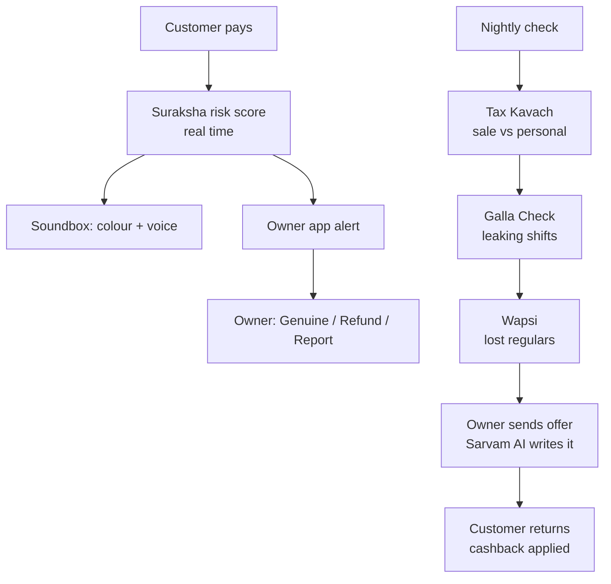

# Munshi AI

**Soundbox tells you money arrived. Munshi tells you what it means.**

Munshi AI is an AI guardian and growth partner for every Paytm merchant. It reads every payment a shop receives and tells the owner whether that money is **safe, taxable, missing, or slipping away**, then helps them act in one tap.

Built for the **Paytm Build for India AI Hackathon** (track: Merchant Growth AI).

---

## Live demo

### 👉 [https://munshi-ai.onrender.com/static/login.html](https://munshi-ai.onrender.com/static/login.html)

| Role | PIN | Opens |
|---|---|---|
| Demo admin | `9999` | Admin panel (opens every other screen) |
| Shop owner | `1111` | Owner app |
| Counter staff | `2222` | Soundbox |
| Customer | `3333` | Customer payment simulator |

> **Note:** the demo runs on Render's free tier. If nobody has used it for a while, the first visit can take **about 1–2 minutes** to wake up and rebuild the demo data. After that it's fast. A restart resets live demo activity (the base demo data always comes back automatically).

---

## The problem

Small merchants lose money in four ways that no app watches today:

| Problem | What happens |
|---|---|
| **Frozen accounts** | A customer pays with fraud money; the police freeze the shop's entire bank account. |
| **Silent leaks** | Staff swap the shop's QR code; payments go to someone else for weeks. |
| **Wrong tax notices** | Family transfers and rent mixed into UPI make sales look bigger, triggering GST notices. |
| **Lost regulars** | Best customers quietly stop coming, and the owner never finds out. |

Today's tools, including Soundbox, only announce that money **arrived**.

## The solution: four AI guardians

| Guardian | What it does |
|---|---|
| 🛡️ **Suraksha** (fraud shield) | Scores every payment in real time. The Soundbox turns green, amber or red and speaks a warning **before goods are handed over**. The owner can mark a payment genuine, refund it to the sender, or report it. If the account still gets frozen, Munshi produces an evidence pack and a bank letter. |
| 🔍 **Galla Check** (leak detector) | Learns what each shift should earn and flags missing money, e.g. a swapped QR code. Includes a QR checker. |
| 🧾 **Tax Kavach** (GST guardian) | Separates real sales from personal money (rent, family, self-transfers), tracks the ₹40 lakh GST limit and predicts the crossing date. Asks the owner only when unsure. |
| 🔁 **Wapsi** (win-back) | Finds regular customers who stopped coming and sends AI-written offers (10% cashback up to ₹50). Cashback is applied automatically when they return. |

---

## How to use the live demo

### 1. Set up (1 minute)

1. Open the [live demo](https://munshi-ai.onrender.com/static/login.html) and log in as **Demo admin** (`9999`).
2. Click **Owner app ↗**, **Soundbox ↗** and **Customer ↗**. Each opens in a new tab, already logged in.
3. Arrange the three tabs side by side: **Customer** (left), **Soundbox** (middle), **Owner** (right).
4. On the Soundbox, click **Turn on Soundbox** once (the browser needs a click before it can play sound). The dot in the top-right corner turns **green** when the live connection is on.

On the Customer page, use the **Demo shortcuts** to fill in a payment, then press **Pay**:

| Shortcut | Shows |
|---|---|
| Regular customer · ₹180 | A normal, safe payment |
| Brand-new UPI account · ₹2,400 | An amber "please verify" warning |
| Mule account · ₹9,000 | A red high-risk warning |
| Lost regular comes back · ₹320 | The Wapsi win-back loop |

### 2. Suraksha: live fraud check

1. **Customer:** pay with each of the first three shortcuts.
2. **Soundbox:** watch it turn **green** (safe, score under 40), **amber** (verify, 40–70) or **red** (high risk, above 70), with the reasons on screen and spoken aloud.
3. **Soundbox:** on an amber or red payment, press **Verified** (hand over the goods) or **Hold** (keep the goods, ask the owner).
4. **Owner:** an alert pops up at the same moment.

### 3. Suraksha: owner decides

1. **Owner → Suraksha tab:** every risky payment, with score, reasons, masked payer and staff action.
2. Choose one action per payment:
   - **Mark genuine:** Munshi trusts this customer next time (no repeat alarm).
   - **Refund to sender:** money goes back only to the original account and is removed from sales and GST.
   - **Report fraud:** the payer is flagged for all future payments, and you get the 1930 helpline and cybercrime.gov.in details.
3. **Soundbox:** speaks the owner's decision to the staff.

### 4. Account frozen? Get help

1. **Owner → Suraksha → Account frozen? Get help.**
2. Fill in the bank and date, and choose the payment that caused the freeze.
3. Click **Prepare evidence and letter.** Munshi collects the evidence (transaction, risk record, staff and owner actions, business history), and Sarvam AI drafts a letter asking the bank to hold only the disputed amount.
4. **Copy** or **Download** the letter. *(A draft, not legal advice. The first generation can take up to 40 seconds.)*

### 5. Galla Check

1. **Owner → Home → Run nightly check** (if it hasn't run yet).
2. **Owner → Galla Check:** the red banner shows the leaking shift, since when, and the estimated loss.
3. Compare the shift cards and the expected vs. actual chart.
4. **QR check:** paste `upi://pay?pa=vikram.k88@ybl&pn=Ramesh Kirana` and click **Check QR**. It shows that this QR pays someone else. Try `upi://pay?pa=rameshkirana@paytm` to see a safe result.

### 6. Tax Kavach

1. **Owner → Tax Kavach:** progress towards the GST limit, the predicted crossing date, and raw UPI vs. personal money vs. real sales.
2. **Try it live:** on the Customer page choose **New customer**, enter ₹18,000, select **Send to number**, type the note `rent`, and pay. The Owner app records it as **personal money** instantly; sales don't change.
3. Answer **Business** or **Personal** on the question cards. Munshi remembers the answer for that person.

### 7. Wapsi: win back lost customers

1. **Customer:** click **Lost regular comes back · ₹320** and note the customer number shown under **My offers**.
2. **Owner → Wapsi:** find that customer number and click **Send offer**.
3. **Customer:** the offer appears under **My offers**.
4. **Customer:** change the amount to `100` and **Pay**. You see "₹10 cashback credited".
5. **Owner:** "Came back after your offer. Paid ₹100, cashback ₹10, you keep ₹90."

### 8. Owner Home

- **Today's sales** counts only real sales; personal money and flagged payments are shown separately.
- **Today's payments** tags each payment: Sale, Personal, Check, High risk, Refunded.
- **Alerts** have **Useful / Wrong alert** buttons. Every tap becomes training data.

### 9. Admin panel and accuracy

- **Reset demo data:** fresh data plus the nightly check, in one click.
- **Run nightly check.**
- **How accurate is Munshi?** compares what each guardian found with the hidden answer key.

### 10. Permissions

Log in as **Staff** in a new tab and open `/static/owner.html`. You're sent back to the login page. Roles are enforced on the server for every request, not just hidden in the screens.

---

## Results

Measured on 7 months of realistic simulated payments for a Mumbai kirana store (22,853 payments, 320 regular customers, festivals, monsoon, salary weeks), with real-world problems hidden in the data:

| Guardian | Hidden in the data | Munshi found |
|---|---|---|
| Suraksha | 5 fraud payments from mule accounts | 5/5 caught, 0 false alarms in 22,848 normal payments |
| Galla Check | QR swap from 12 Oct, ₹96,778 diverted | Found from 12 Oct exactly, estimated ₹98,117 (1.4% off) |
| Tax Kavach | ₹6.2 lakh of family, rent and self-transfers | 100% correctly classified, 43/43 separated |
| Wapsi | 6 high-value regulars stopped coming | 6/6 found, 0 false alarms, 9 more explained by the QR leak |

These results prove the logic on known problems. Real-world accuracy would be tuned using merchant feedback, which the app already collects.

---

## How it works



| Path | When | What |
|---|---|---|
| **Real time** | Every payment | Suraksha scores it; the result is pushed live to the Soundbox and Owner app over WebSockets |
| **Nightly** | Once a day (button in the demo) | Tax Kavach → Galla Check → Wapsi, in that order, because each uses the previous result |
| **On demand** | When the owner taps | Sarvam AI writes the bank letter and offer messages |

## AI used

| Type | Model | Used for | Why |
|---|---|---|---|
| Generative AI | Sarvam AI `sarvam-105b` | Win-back offers, bank letters | Natural, personal language at scale. Guard rails: fixed offer terms, completeness checks, template fallback. The AI never makes money decisions. |
| Speech AI | Sarvam AI Bulbul v3 | Soundbox voice alerts | Natural Indian voice; the browser's built-in voice is the backup |
| Explainable decision AI | Built in Python | Risk scoring, time-series anomaly detection, sale/personal classifier with active learning, churn detection | Every money decision shows *why* |

## Tech stack

| Layer | Technology |
|---|---|
| Backend | Python, FastAPI |
| Real-time | WebSockets |
| Database | SQLite (same SQL moves to PostgreSQL) |
| Analytics | pandas, NumPy |
| Synthetic data | Faker, NumPy (fixed seed, reproducible) |
| AI | Sarvam AI APIs |
| Front end | HTML, Tailwind CSS, Chart.js |
| Hosting | Render |

---

## Project structure

```
munshi-ai/
├── main.py              # FastAPI app: all API routes, WebSockets, login and role checks
├── db.py                # Database tables, default settings, demo PINs
├── generator.py         # 7 months of realistic shop data with hidden planted events
├── check_setup.py       # One-command setup check (packages, keys, Sarvam)
├── render.yaml          # Render deployment blueprint
├── requirements.txt
├── .env.example         # Copy to .env and add your Sarvam key
├── modules/
│   ├── suraksha.py      # Real-time payment risk scoring
│   ├── galla.py         # Missing-money detection per shift + QR check
│   ├── tax.py           # Sale vs personal classification + GST tracking
│   ├── wapsi.py         # Lost-regular detection (linked with Galla)
│   ├── nightly.py       # Runs the batch checks in order + measures accuracy
│   ├── llm.py           # Sarvam chat with cache and template fallback
│   └── voice.py         # Sarvam text-to-speech with cache
└── static/
    ├── login.html       # Role picker + PIN
    ├── auth.js          # Shared login guard
    ├── customer.html    # Customer payment simulator
    ├── staff.html       # Soundbox screen
    ├── owner.html       # Owner app (Home, Suraksha, Galla Check, Tax Kavach, Wapsi)
    └── admin.html       # Demo admin panel
```

## Run locally

Requires Python 3.11 or newer and a [Sarvam AI](https://www.sarvam.ai) API key (optional: without it, the app uses the browser voice and template text).

```bash
git clone https://github.com/YOUR-USERNAME/munshi-ai.git
cd munshi-ai
python -m venv venv
venv\Scripts\activate          # Windows
# source venv/bin/activate     # macOS / Linux
pip install -r requirements.txt
copy .env.example .env         # Windows  (cp .env.example .env on macOS / Linux)
# edit .env and add your SARVAM_API_KEY
python check_setup.py          # optional: checks everything is ready
uvicorn main:app --reload
```

Open [http://127.0.0.1:8000](http://127.0.0.1:8000). Demo data is generated automatically on the first start.

## Deploy on Render

1. Push this repository to GitHub (`.env` is excluded by `.gitignore`).
2. On [render.com](https://render.com): **New + → Blueprint** → choose the repository. Render reads `render.yaml`.
3. Enter your `SARVAM_API_KEY` when asked, then deploy.

---

## Privacy and security

- Four roles, enforced on the server for every request. Staff can never see leak reports.
- Owners see only hashed customer IDs (e.g. `C-797A9B8C`), never names or UPI IDs.
- Offers go only to customers who opted in.
- Payer UPI IDs are masked in the bank letter.

## Limitations

- One simulated shop; network signals (how many shops a payer used today, money passing straight through) are simulated.
- Risk weights and thresholds are hand-tuned, explainable starting points.
- Galla Check needs about 8 weeks of history before it can judge a shift.
- Cashback and refunds are simulated; no real money moves.

## Roadmap

- Train ML models (e.g. gradient-boosted trees for fraud, forecasting for leaks) on real Paytm data using the feedback labels already collected.
- Hindi, Marathi and other regional-language Soundbox alerts.
- Real Soundbox integration via MQTT; a pilot with 500 merchants.

---

## Author

**Sameer Shaik** · [sameer8367s@gmail.com](mailto:sameer8367s@gmail.com)
